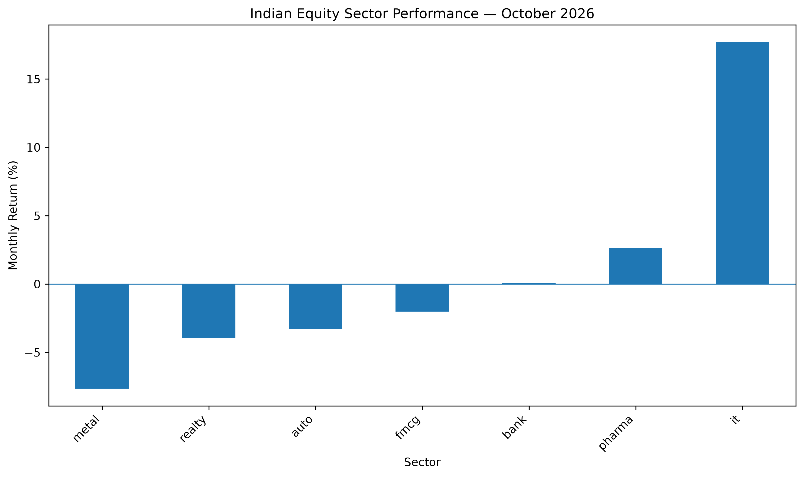
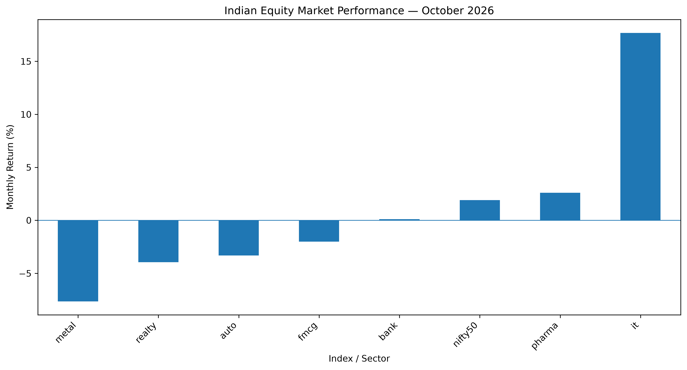

# Indian Equity Sector Rotation Report — October 2026

## Market Overview

The Indian equity market delivered a mixed performance during **October 2026**, with substantial differences in performance across sectors.

The monthly analysis examines the NIFTY 50 benchmark, sector-level returns and stock-level performance to identify areas of relative market strength and weakness.

## NIFTY 50 Performance

The **NIFTY 50 returned +1.91%** during October 2026.

This benchmark provides a reference point for evaluating the relative performance of individual sectors.

## Sector Leadership

The strongest-performing sector was **IT**, returning **+17.69%**.

It outperformed the NIFTY 50 by **+15.78 percentage points**.

The weakest-performing sector was **Metal**, returning **-7.65%**.

It underperformed the NIFTY 50 by **9.56 percentage points**.

## Sector Performance

| Sector | Monthly Return | Difference vs NIFTY 50 |
|---|---:|---:|
| IT | +17.69% | +15.78 pp |
| Pharma | +2.60% | +0.69 pp |
| Bank | +0.10% | -1.81 pp |
| FMCG | -2.02% | -3.93 pp |
| Auto | -3.31% | -5.22 pp |
| Realty | -3.95% | -5.86 pp |
| Metal | -7.65% | -9.56 pp |

## Sector Rotation Analysis

The monthly return distribution highlights differences in sector leadership.

Sectors outperforming the NIFTY 50 demonstrated stronger relative performance during the month, while underperforming sectors lagged behind the benchmark.

These differences provide useful observations for tracking changes in market leadership over time.

However, a single month's return does not establish a persistent sector-rotation trend. Multiple months of observations are needed to assess whether relative strength is sustained.

## Performance Charts

## Top-Performing Stocks by Sector

### Auto

1. TVS Motor
2. Eicher Motors
3. Hero MotoCorp

### Bank

1. Kotak Mahindra Bank
2. Federal Bank
3. ICICI Bank

### FMCG

1. Tata Consumer
2. Marico
3. ITC

### IT

1. Wipro
2. TCS
3. Infosys

### Metal

1. JSW Steel
2. Hindalco
3. Vedanta

### Pharma

1. Dr Reddy
2. Zydus
3. Divis Lab

### Realty

1. DLF
2. Phoenix Mills
3. Prestige Estates

## Weakest-Performing Stocks by Sector

### Auto

1. Ashok Leyland
2. Bajaj Auto
3. Maruti Suzuki

### Bank

1. AU Small Finance Bank
2. IndusInd Bank
3. HDFC Bank

### FMCG

1. Nestle India
2. Britannia
3. Dabur

### IT

1. Persistent Systems
2. Coforge
3. HCL Tech

### Metal

1. SAIL
2. Hindustan Zinc
3. Jindal Steel

### Pharma

1. Sun Pharma
2. Lupin
3. Mankind

### Realty

1. Macrotech Developers
2. Brigade Enterprises
3. Sobha

## Data Quality and Coverage

Stock-level rankings are based on stocks with valid monthly return observations in the processed ranking files. Stocks without valid price data may be excluded from the rankings.

- Report data-quality status: **complete**
- Sector summaries loaded: **7/7**

## Key Takeaways

- NIFTY 50 gained +1.91%.
- IT led sector performance with +17.69%.
- Metal was the weakest sector with -7.65%.
- Sector-level comparisons revealed differences in relative strength.
- Stock rankings provided additional insight into performance within each sector.
- Continued monthly tracking can help identify persistent changes in sector leadership.

## Methodology

This report was generated using the **Indian Equity Sector Rotation Research** pipeline.

The research workflow combines:

- Indian equity index price data
- Monthly sector return calculations
- Individual stock return analysis
- Sector-wise stock rankings
- Top and bottom stock summaries
- Automated monthly JSON reporting
- Markdown report generation

Monthly returns are calculated using closing-price observations. Sector returns are evaluated against the NIFTY 50 benchmark.

The analysis is intended for research and educational purposes and should not be interpreted as investment advice.

---

*Generated automatically by the Indian Equity Sector Rotation Research Pipeline.*

**Report:** October 2026

**Data period:** 2026

